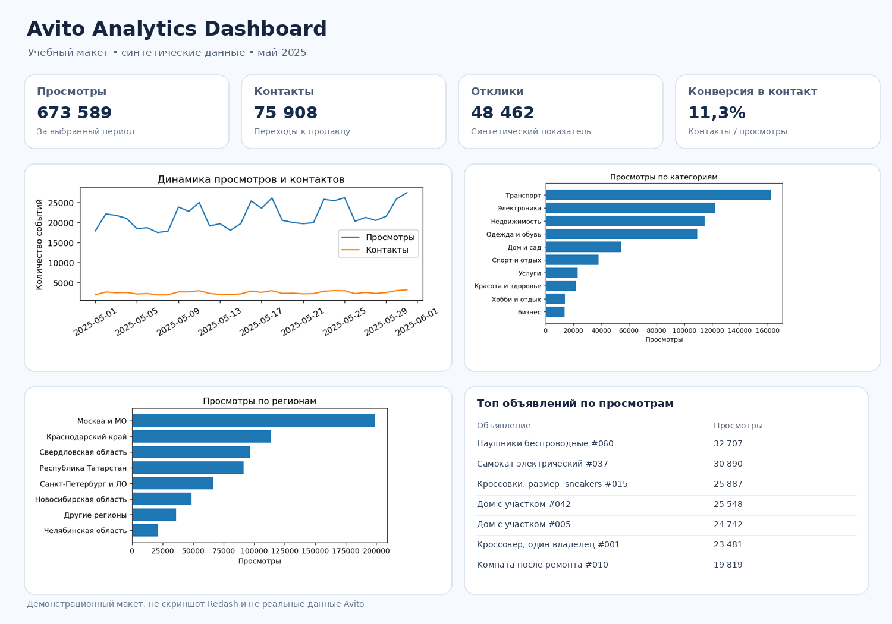

# Avito Analytics Dashboard (portfolio project)

Учебный проект по аналитике данных для классифайд-платформы: SQL-расчёты, подготовка метрик и визуализации в Redash на базе PostgreSQL.

> **Disclaimer:** это независимый учебный проект. Все данные синтетические; проект не связан с внутренними системами Avito и не отражает реальные показатели компании.

## Что демонстрирует проект

- SQL-агрегации и соединения таблиц в PostgreSQL.
- Расчёт KPI и конверсии из просмотров в контакты.
- Анализ динамики по дням.
- Сравнение категорий и регионов.
- Рейтинг объявлений по просмотрам.
- Базовые проверки качества данных.
- Представление результатов в Redash.

## Структура репозитория

```text
avito-analytics-dashboard/
├── data/                  # Синтетические CSV-данные
├── docs/metrics.md         # Определения метрик и методология
├── screenshots/            # Пример визуализации для README
├── sql/
│   ├── 00_load_csv_example.sql
│   ├── 01_create_tables.sql
│   ├── 02_kpi_metrics.sql
│   ├── 03_daily_dynamics.sql
│   ├── 04_category_analysis.sql
│   ├── 05_region_analysis.sql
│   ├── 06_top_listings.sql
│   └── 07_data_quality_checks.sql
└── README.md
```

## Данные

В `data/` находятся:
- `listings.csv` — 80 объявлений с категориями, регионами, ценой и статусом.
- `listing_daily_stats.csv` — дневные показатели за 1–31 мая 2025 года.

Это синтетический набор, подготовленный специально для демонстрации. Персональные данные отсутствуют.

## Быстрый запуск PostgreSQL

Нужен установленный PostgreSQL и клиент `psql`.

1. Создайте базу:
   ```bash
   createdb avito_analytics
   ```
2. Выполните создание таблиц из корня репозитория:
   ```bash
   psql -d avito_analytics -f sql/01_create_tables.sql
   ```
3. Загрузите CSV из корня репозитория. Команды `\copy` нужно выполнять в интерактивном `psql`:
   ```sql
   \copy listings(listing_id, title, category, region, price_rub, published_date, status) FROM 'data/listings.csv' WITH (FORMAT csv, HEADER true, ENCODING 'UTF8');
   \copy listing_daily_stats(listing_id, event_date, views, contacts, responses) FROM 'data/listing_daily_stats.csv' WITH (FORMAT csv, HEADER true, ENCODING 'UTF8');
   ```
   Если `psql` запущен не из корня проекта, укажите абсолютные пути к CSV.
4. Проверьте данные:
   ```bash
   psql -d avito_analytics -f sql/07_data_quality_checks.sql
   ```
5. Выполните запросы из `sql/02_...sql` — `sql/06_...sql`.

## Настройка Redash

1. Запустите или откройте доступный экземпляр Redash.
2. Добавьте PostgreSQL как Data Source, указав параметры вашей базы.
3. Создайте запросы, скопировав SQL из `sql/02_kpi_metrics.sql` — `sql/06_top_listings.sql`.
4. Создайте визуализации:
   - KPI — значения из `02_kpi_metrics.sql`;
   - Line Chart — `03_daily_dynamics.sql`;
   - Bar Chart — `04_category_analysis.sql`;
   - Bar Chart или Table — `05_region_analysis.sql`;
   - Table — `06_top_listings.sql`.
5. Добавьте визуализации на один Dashboard и назовите его **Avito Analytics Dashboard**.
6. Сохраните скриншоты настоящего Redash-дашборда в `screenshots/`, заменив демонстрационный макет.

## Визуальный пример

Изображение `screenshots/dashboard_mockup.png` — концептуальный макет оформления, а не скриншот работающего Redash и не подтверждение реальных данных Avito.



## Ключевые метрики

Подробные определения приведены в [`docs/metrics.md`](docs/metrics.md). В проекте используются просмотры, контакты, отклики, контактная конверсия и показатели по категориям/регионам.

## Возможные дальнейшие улучшения

- Добавить параметры периода, категории и региона в Redash.
- Настроить автоматическое обновление данных.
- Добавить сравнение периодов и сегментацию объявлений.
- Добавить тесты SQL-метрик и CI-проверки.

## Как описать проект в резюме

> Разработала учебный аналитический проект на PostgreSQL и Redash: подготовила SQL-запросы для расчёта KPI, динамики просмотров и контактов, анализа категорий и регионов; построила структуру дашборда и документировала метрики. Использовала синтетические данные для воспроизводимой демонстрации аналитического процесса.
